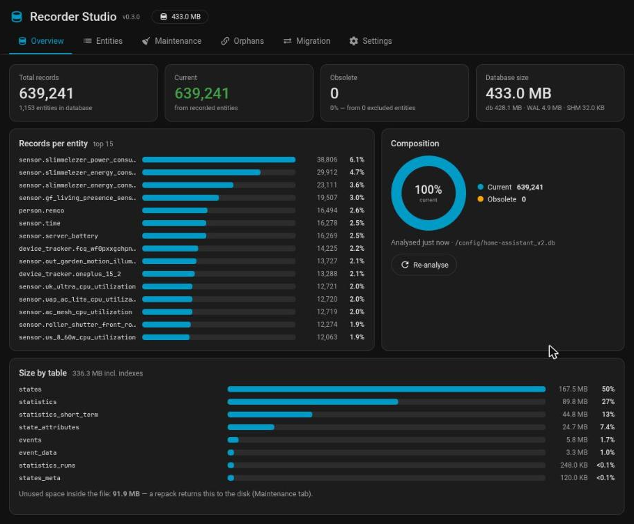
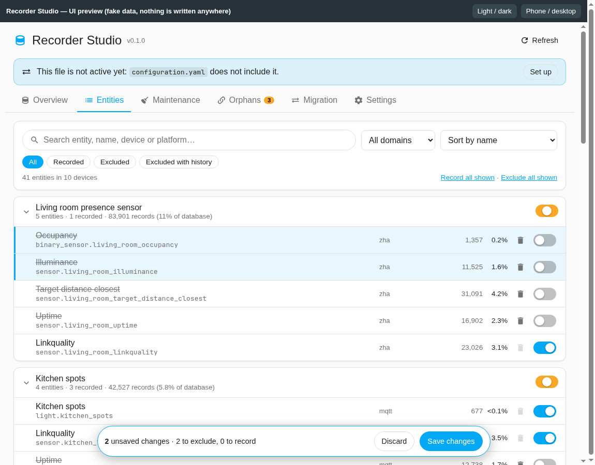
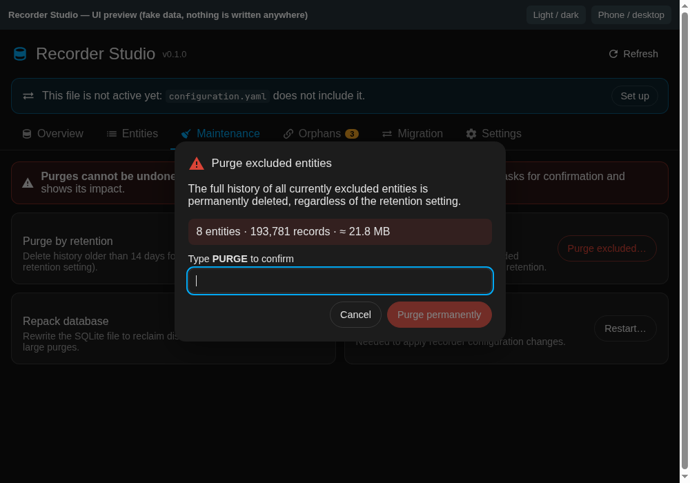
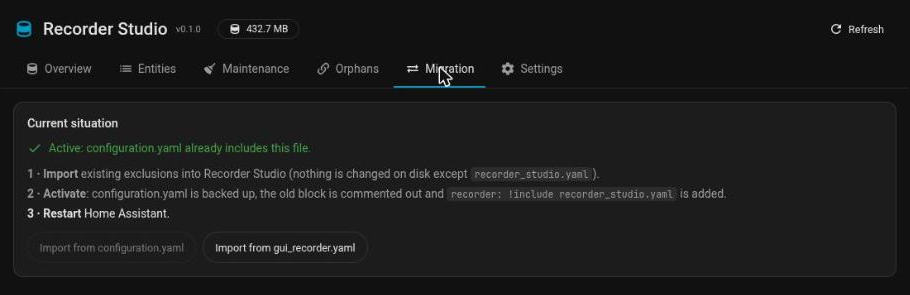

# Recorder Studio

[](https://my.home-assistant.io/redirect/hacs_repository/?owner=r3mcos3&repository=recorder-studio&category=integration)

**Take control of what Home Assistant records, from a modern sidebar panel instead of YAML.**

Home Assistant's `recorder` stores the state history of every entity in a database. Over time a handful of noisy
entities (uptime counters, link quality, signal strength, …) can account for most of it. Recorder Studio shows you
exactly which entities take up how much of the database, lets you stop recording them with a toggle, and cleans up the
history that is no longer wanted.

> **SQLite only.** Other backends (MariaDB, PostgreSQL) are refused at setup.



## Features

- **Per device / per entity recording control.** Switch recording on or off for a whole device or a single entity,
  review the changes, then save them in one go. The result is written to a generated `recorder_studio.yaml`.
- **See what fills your database.** Total, current and obsolete records, the top entities, and **each entity's and
  device's share of the database in percent**.
- **See how big the database is.** The total size (database + WAL + SHM) is always shown next to the title. After an
  analysis you also get the size per table (states, attributes, statistics, events, …) including indexes, and how much
  unused space a repack would return to the disk.
- **Search and filter.** Search by entity id, name, device or platform; filter by domain or status (recorded, excluded,
  excluded but still has history); sort by name or by share of the database.
- **Safe maintenance.** Purge by retention, purge the history of excluded entities, purge a single entity or a whole
  device, repack the database, restart Home Assistant. Every destructive action shows its estimated impact and asks for confirmation;
  bulk purges require typing `PURGE`.
- **Orphaned exclusions.** Finds excluded entities that no longer exist and have no history, with a one-click clean-up.
- **Guided migration.** Imports an existing `recorder:` block from `configuration.yaml` (or the output of GUI Recorder)
  and switches `configuration.yaml` to the generated file, with a diff preview and an automatic backup.
- **Follows your theme.** Light and dark, responsive down to phone width, keyboard accessible.



*(Screenshots are taken from the built-in preview with fake data.)*

## Requirements

- Home Assistant 2024.11 or newer, with the default **SQLite** recorder.
- An admin user (the panel and its API are admin-only).
- No Node or Python tooling: the panel is plain JavaScript with [Lit](https://lit.dev) bundled in.

## Installation

### HACS (recommended)

1. Click the button at the top of this page, or in HACS open the three-dot menu > **Custom repositories**, add
   `https://github.com/r3mcos3/recorder-studio` with category **Integration**.
2. Download **Recorder Studio** and restart Home Assistant.
3. Go to **Settings > Devices & services > Add integration** and choose **Recorder Studio**.
4. Open **Recorder Studio** in the sidebar.

> HACS can only download a repository that is public (or reachable with a GitHub token).

### Manual

Copy the `custom_components/recorder_studio/` folder into `<config>/custom_components/`, restart Home Assistant and
continue with step 3 above.

## First steps

1. **Analyse the database.** On the Overview tab click *Analyse database*. This is read-only and may take a moment
   on a large database (the per-table sizes read every page of the file). The total size is visible without it. Statistics are never refreshed automatically; click *Re-analyse* after changes.
2. **Check the situation.** The Migration tab tells you whether `configuration.yaml` already includes
   `recorder_studio.yaml`. If not, a blue banner offers a *Set up* shortcut.
3. **Migrate** once (see [Migration](#migration)).
4. **Pick what to stop recording** on the Entities tab, save, and restart Home Assistant when the banner asks for it.
5. **Clean up** the history you no longer want on the Maintenance tab.

## The tabs

| Tab | What it does |
| --- | --- |
| **Overview** | Total / current / obsolete records, database size split into file / WAL / SHM, records per entity with percentage, composition chart, size per table and reclaimable space. *Obsolete* means records that still exist for entities that are now excluded. |
| **Entities** | Device tree with a recording toggle per device and per entity, records and share per row, search, filters and sorting. Changes stay pending until you press **Save changes** (a bar at the bottom shows how many). A trash button on every entity and every device purges its history (after an analysis, so the impact can be shown). |
| **Maintenance** | Purge by retention, purge excluded entities, repack, restart Home Assistant. |
| **Orphans** | Excluded entities that no longer exist anywhere and have no history. Remove them in bulk; nothing is deleted from the database. |
| **Migration** | Import an existing recorder config and activate the include in `configuration.yaml`. |
| **Settings** | Retention (`purge_keep_days`), auto purge, auto repack, commit interval, and optional manual rules. |

### Manual rules

Individual entities are managed with the toggles. For broader rules, the Settings tab accepts a small YAML block:

```yaml
exclude:
  entity_globs:
    - sensor.*_uptime
  domains:
    - update
  event_types:
    - call_service
include:
  domains: []
  entity_globs: []
```

Only `exclude.{domains,entity_globs,event_types}` and `include.{domains,entity_globs}` are accepted. Anything else
(including `entities`, which the toggles own) is rejected with a message and never written.

## Maintenance



> **Purges are permanent and cannot be undone. Make a full Home Assistant backup first.**

- **Purge by retention** calls `recorder.purge` with your `purge_keep_days` and deletes everything older.
- **Purge one entity or a device** (trash buttons on the Entities tab) calls `recorder.purge_entities` with
  `keep_days: 0` for exactly the entities shown in the dialog. A device purge always covers all entities of that device,
  even when a search filter is active. If some of them are still recorded, the dialog says so.
- **Purge excluded entities** calls `recorder.purge_entities` with `keep_days: 0` for all currently excluded
  entities, ignoring retention. The dialog shows the entities, records and approximate size first.
- **Repack** calls `recorder.purge` with `repack: true` (so retention is applied too). It needs free disk space of
  roughly the database size and can block the recorder for several minutes.
- **Restart Home Assistant** is needed to apply recorder configuration changes. Home Assistant validates the
  configuration first and refuses to restart on errors.

Purges are queued by the recorder. After a purge the panel re-analyses the database by itself (a few times, until the numbers stop changing), so the statistics are live without a manual *Re-analyse*.

## How it works

1. Your choices are stored in `.storage/recorder_studio.data` and rendered to **`recorder_studio.yaml`** in your
   config folder (written atomically, so Home Assistant never reads a half-written file).
2. `configuration.yaml` contains `recorder: !include recorder_studio.yaml`. The Migration tab sets this up.
3. The recorder reads that file **at startup**, so changes need a restart. The panel tells you when one is pending.
4. Statistics are read with a strictly **read-only** SQLite connection. Anything that changes data goes through the
   official `recorder.*` services.

Nothing is written at startup; installing the integration alone changes nothing on disk.

## Migration

Open **Migration** (or click *Set up* in the banner). Two steps, each with its own confirmation:

1. **Import** the existing exclusions into Recorder Studio, either from the inline `recorder:` block in
   `configuration.yaml` or from a standalone file such as GUI Recorder's `gui_recorder.yaml` (read only, never
   modified). Unsupported options are listed as warnings instead of being dropped silently, and values that use YAML
   tags such as `!secret` are never imported as plain text.
2. **Activate.** A diff shows exactly what changes in `configuration.yaml`. On confirmation the file is backed up as
   `configuration.yaml.recorder_studio_backup_<timestamp>`, the old `recorder:` block is commented out and
   `recorder: !include recorder_studio.yaml` is added.

Then restart Home Assistant. To go back at any time, point the include at the old file or restore the backup.



### Coming from GUI Recorder

Import from `gui_recorder.yaml`, activate, restart, and check that the Migration tab shows *Active*. After that you
can uninstall GUI Recorder. Keep `gui_recorder.yaml` for a while as a fallback; it is inert once
`configuration.yaml` no longer includes it.

## Uninstalling

Removing the integration does not touch your database or `recorder_studio.yaml`. Because
`recorder: !include recorder_studio.yaml` is plain Home Assistant YAML, your recording behaviour keeps working
without the integration. To leave `configuration.yaml` tidy, copy the content of `recorder_studio.yaml` (below the
two comment lines) into an inline `recorder:` block and remove the include.

## Safety

- Every destructive action shows its impact and needs confirmation; bulk purges need `PURGE` typed.
- All websocket commands are admin-only; destructive ones also require an explicit `confirm: true`.
- `configuration.yaml` is backed up before it is changed, and files are written atomically.
- Optional **read-only mode**: set `READ_ONLY_MODE = True` in `custom_components/recorder_studio/const.py` to refuse
  every write action while statistics and lists keep working.

## Troubleshooting

| Problem | What to try |
| --- | --- |
| Panel does not appear | Add the integration under *Devices & services*, then hard-refresh (Ctrl+Shift+R). The panel is admin-only. |
| Log says "supports SQLite only" | The recorder uses another database backend; this integration cannot be used. |
| Panel or icon looks outdated | Hard-refresh the browser. After updating the files, restart Home Assistant. |
| Banner says the file is not active | `configuration.yaml` does not include `recorder_studio.yaml`; use *Set up* on the Migration tab. |
| Statistics are empty | Click *Analyse database*; it is never run automatically. |
| Changes have no effect | The recorder reads its configuration at startup. Restart Home Assistant. |

## Limitations

- SQLite only.
- Purging works per entity, per device, for all excluded entities, or by retention. It needs a recent analysis, because
  the confirmation dialog shows the impact first. Entities without a device cannot be purged as a group.
- Recording changes need a Home Assistant restart.
- The per-table sizes need SQLite's `dbstat` module; if your SQLite build lacks it, that card is simply hidden.
- Re-enabling recording for an entity that one of your manual domain/glob rules excludes is not supported; remove or
  narrow the rule instead.

## Development

```bash
uv venv .venv && uv pip install --python .venv/bin/python pytest pyyaml
.venv/bin/python -m pytest
python3 scripts/build_preview.py   # rebuilds preview/preview.html
```

- `custom_components/recorder_studio/core/` is pure Python with no Home Assistant imports (rules, YAML rendering,
  SQLite analysis, migration, device tree) and is unit-tested against a synthetic SQLite database.
- The Home Assistant glue is `service.py`, `websocket_api.py`, `panel.py`, `storage.py` and `config_flow.py`.
- The panel is a single [Lit](https://lit.dev) module (`frontend/recorder-studio-panel.js`), vendored in
  `frontend/vendor/`, with no build step.
- **UI preview without Home Assistant:** open `preview/preview.html` in a browser (one file, fake data, writes
  nothing). Deep links: `preview.html#analyze&tab=entities&open=all&theme=dark&phone`.

## Credits and license

Independent re-implementation inspired by the functionality of
[GUI Recorder](https://github.com/martinandersen84/gui-recorder) (MIT); no code was copied. Panel built with
[Lit](https://lit.dev) (BSD-3-Clause, vendored). Released under the [MIT license](LICENSE).
